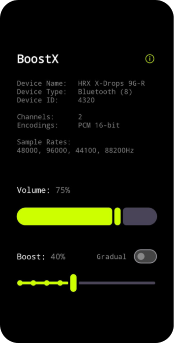
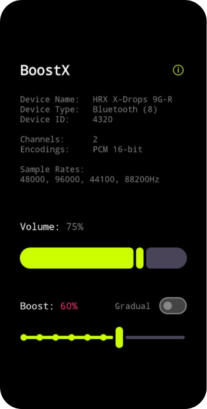
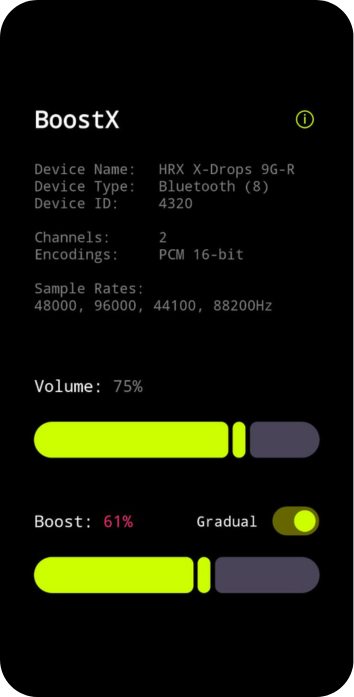

<div align="center">

# BoostX 


   

BoostX is a minimal yet powerful sound enhancement tool that allows users to boost audio levels beyond system limits with sliders for fine adjustments, and real-time audio device insights.
</div>


## Features

- Hardware- and thermal-aware loudness boost (`HardwareProfile`) with per-route safety ceilings across speaker, wired, USB, Bluetooth, LE Audio, and line/HDMI outputs.
- Multi-stage audio engine using `DynamicsProcessing` (pre-EQ, 3-band multiband compressor, true-peak limiter) on Android 9+ (API 28+), with `LoudnessEnhancer`, `Equalizer`, `BassBoost`, and `Virtualizer` fallback.
- Adjustable volume and boost sliders with discrete (default) and continuous (gradual) modes.
- Sound Enhancement (Clarity & Depth), 5 presets (Balanced, Vocal, Bass, Movie, Night), Left/Right Balance, Noise Gate, Auto Loudness normalization, Call Boost, and Hold-to-Compare A/B bypass.
- Per-device saved profiles, Quick Settings tile, optional start-on-boot, and real-time output device, codec, and headroom insights.

## Screenshots

<div align="center">
   
   
   
</div>

## Download

BoostX will be available on F-Droid.

For now, the latest APK can be downloaded from [Releases](https://github.com/AumGupta/BoostX/releases).

## Development

### Tech Stack & Libraries Used

- Kotlin with Android XML layouts (`AppCompatActivity`) and Material Components for Android.
- Android audio & platform APIs: `AudioManager`, `DynamicsProcessing`, `LoudnessEnhancer`, `Equalizer`, `BassBoost`, `Virtualizer`, `Visualizer`, `PowerManager` thermal status API, and `TileService`.
- Persistent background processing via a foreground service (`AudioBoostService`).

### How to Contribute

1. Fork the repository.
2. Clone your fork:
   ```sh
   git clone https://github.com/AumGupta/BoostX.git
   ```
3. Open the project in Android Studio, build, and test. 
4. Submit a Pull Request with your improvements.

## License
BoostX is licensed under the [GNU General Public License v3.0 (GPL-3.0)](https://github.com/AumGupta/BoostX?tab=GPL-3.0-1-ov-file).

## Support & Feedback
For suggestions, feature requests, or bug reports, open an issue on the [Issues](https://github.com/AumGupta/BoostX/issues) page.

If you find BoostX useful, consider starring the repository on GitHub.
